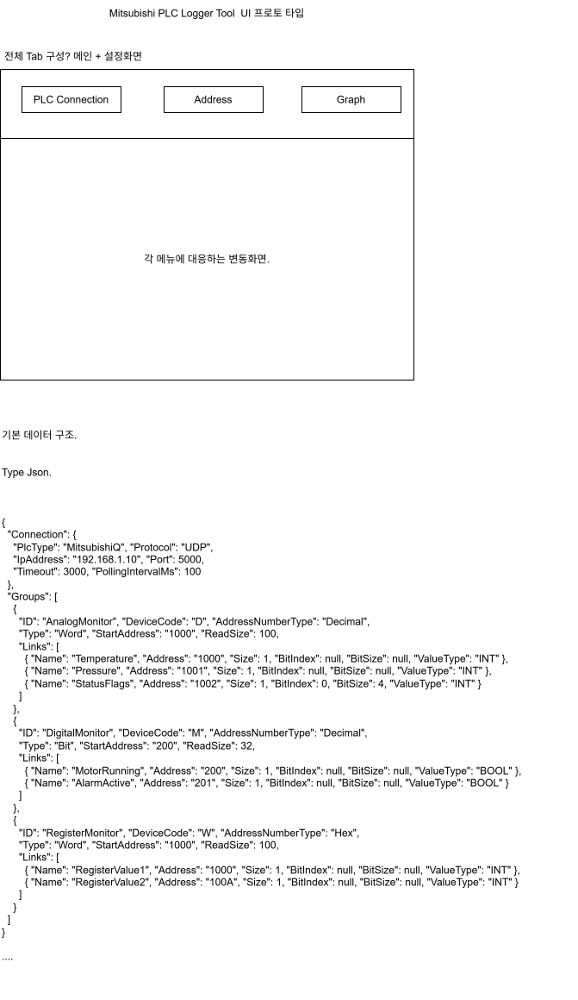

미쓰비시 Q/R 시리즈를 지원하는 PLC 로깅 툴.

MX컴포넌트 대신 NewLife.Melsec 사용하여 3E 프로토콜을 사용한 PLC통신기능.

Q/R시리즈에서 3E프로토콜 사용시 UDP:5000를 특별한 포트 설정 없이 지원하므로, 별도로 표기하여 지원.

SOEM Frontend 에서 사용했던 Serilog 로깅 코드를 이용한 CSV 기록,

UI는 Avalonia, 그래프는 Scottplot, dotnet 10.0 대상진행.

덤으로 안드로이드 지원 추가. 휴대폰에서 간편하게 로깅 되도록.
이때 추가 권한은 INTERNET권한.(TCP/UDP통신을 위한)
INTERNET

FOREGROUND_SERVICE

FOREGROUND_SERVICE_CONNECTED_DEVICE

CHANGE_NETWORK_STATE

POST_NOTIFICATIONS

기본적인 데이터 처리.

상태머신으로 시리얼하게 처리.

IDLE - PLC_READ - Value UPDATE - CSV LOGGING - WAIT(Polling Time) 구조의 상태머신.

